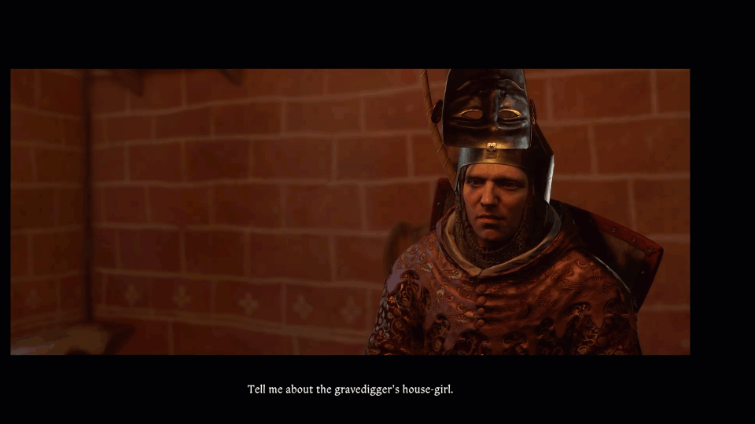

# Moonshine AI for Kingdom Come: Deliverance II

[This mod](https://download.moonshine.ai/kcd2/0.9.102.28/Moonshine-0.9.102.28-setup.exe) gives every unnamed villager, beggar, miner and varlet in Kuttenberg and Trosky a
name, history, [friends](https://liber.moonshine.ai) , family, and a *Talk* option. Speak to them through your microphone and they answer in character, in their own voice, about their own work and lives. Everything runs on your own PC, and as installed nothing you say leaves it.

[](https://www.youtube.com/watch?v=ytNBseHc7dk)

[youtube.com/watch?v=ytNBseHc7dk](https://www.youtube.com/watch?v=ytNBseHc7dk)

Originally I wrote this for myself as "fan fiction" after I'd completed the game and wanted
to experience more stories in the amazing world the Warhorse team built. It uses AI heavily, but I hope also thoughtfully. You'll have to judge if it's a successful experiment, but I'm trying to explore how local, decentralized AI can augment, not replace, human creativity. The code is open source under an MIT license, available at
https://github.com/moonshine-ai/moonshine-kcd.

This is an early build: it will do weird things, and I very much appreciate [all the bug
reports you can share](https://github.com/moonshine-ai/moonshine-kcd2-ai/issues). The AI-generated speech also sounds rough, especially for a game that's known for its voice acting. I am hiring professional actors for the dialog that's known ahead of time, and licensing their voices for better clones for freeform speech.

## Player Guide

Load a saved game and walk up to anybody who would have been unnamed, like a Hired Hand or Housemaid, and you'll see a name above their head. Once you're close enough, a new Chat option will appear.

Start a conversation, you'll see a custom greeting and a new set of dialog options. You can pick any of these, or if there's something different you're interested in, hold down RT (or V on the keyboard) and speak into the microphone.

Your partner will answer in their own voice, based on what they know, and how they feel about you. These conversations are remembered over time, and people are likely to be more patient and open with questions as they get to know you better. As installed, none of this leaves your machine: it's all running completely locally. (The app can be pointed at a model service of your choosing instead, see *Using a different model* below; that is off unless you turn it on.)

Some of these newly-named people need your help. You'll see them marked on a map, and they may even call you over as you pass. There are over fifty new stories to play through, and I'm hoping the community will add more over time.

If you'd like to know more about the lives of these characters, you can browse the [Liber Vultuum](https://liber.moonshine.ai/).

## Installing

Two pieces go on your computer, and one installer puts both in place:

1. **The mod**, a small folder in the game's `mods` folder. It gives people their names
   and the *Talk* option.
2. **The Moonshine app**, about 4 GB, most of it the language model and the
   characters' knowledge, which the installer downloads while it runs. It runs beside the
   game in its own window.

The mod without the app renames people but they have nothing to say. The app without the
mod has nobody to talk to.

Each step below ends with what you should see. If you see something else, go to
*If something goes wrong* below.

### Before you start

- **Windows 10 or 11**, 64-bit.
- **Kingdom Come: Deliverance II on Steam**, updated to the current version (1.5.6). The
  GOG and Epic versions are not supported.
- **16 GB of RAM** at least; **32 GB is recommended**. With 16 GB the game and the model
  share memory and the first answer each session comes slower. The app uses the CPU, not
  the graphics card, so the game keeps the GPU to itself.
- **10 GB free** on your Windows drive (the app installs under your user folder, not the
  game's).
- **An internet connection** for the install: about 4 GB is downloaded. On a slow line
  this is the longest part, and the installer can be left to it.
- **A microphone**, if you want to speak to people rather than type. Optional.
- A Steam account that owns the game, signed in on this PC.

Start the game once on its own before installing anything, so Steam has finished
updating it and the game has written its settings. Then quit it; the installer wants the
game closed.

### Step 1: Download the installer

Download [download.moonshine.ai/kcd2/0.9.102.28/Moonshine-0.9.102.28-setup.exe](https://download.moonshine.ai/kcd2/0.9.102.28/Moonshine-0.9.102.28-setup.exe); it is around
40 MB. It is the only file you need: the models and the rest come down while it runs.

**You should see** `Moonshine-<version>-setup.exe` in your Downloads folder.

### Step 2: Run the installer

1. Double-click `Moonshine-<version>-setup.exe`.
2. Windows shows a blue **"Windows protected your PC"** box, because the installer is
   not signed with a certificate Windows recognises. Click **More info**, then
   **Run anyway**.
3. A small box asks whether to install for all users or only for you. Choose
   **Install for me only**. (Installing for all users needs administrator rights and is
   not needed.)
4. If a box says the game was not found in a Steam library, something is off: the
   installer cannot put the mod in place without the game. Click **No**, make sure the
   game is installed through Steam and has been started once, and run the installer
   again. (If the game really is somewhere unusual, see *If something goes wrong*.)
5. **Welcome**: click **Next**.
6. **License Agreement**: this lists the open-source software and model weights inside
   the app and their licences. Choose **I accept the agreement**, then **Next**.
7. **Information**: notes about the build. **Next**.
8. **Select Destination Location**: leave the default,
   `C:\Users\<you>\AppData\Local\Moonshine`. **Next**.
9. **Select Additional Tasks**:
   - *Put a Moonshine shortcut on the desktop*: leave ticked.
   - *Install the mod into the game's mods folder*: leave **ticked**. Untick it only if
     you chose the Workshop route below instead.

   **Next**, then **Install**.
10. The program is copied, then the installer downloads the model, voice and data files,
    about 4 GB in all. The status line names the file it is on and the bar covers the
    whole download; on a 100 Mbit/s line expect about six minutes, on a slower one
    longer. Leave it to run.

    If the connection drops, the installer says which file failed and offers **Retry**.
    Retry when the connection is back. If you **Cancel** instead, nothing is lost: run
    the installer again later and it continues with the files it does not have yet.
11. Near the end, if your PC does not already have the Microsoft Visual C++ runtime, a
    Windows **User Account Control** prompt asks for permission to install it. Click
    **Yes**. This is the only step that asks for administrator rights. If the PC has no
    Microsoft Edge WebView2 either (Windows 11 comes with it, and nearly every Windows 10
    PC has it), the installer adds that as well, which takes a minute.
12. **Finished**: leave **Open Moonshine now** ticked. *Read the guide* opens this text
    and can stay unticked. Click **Finish**.

**You should see** the Moonshine window. For a moment it says *Checking the
installation*, then **Ready to play**, with a **Play** button. You can close it for now,
or carry straight on to Step 3.

If it says something else (*Some of Moonshine's files are missing*, *Kingdom Come:
Deliverance 2 was not found*), the button under the message is the fix; see *If
something goes wrong*.

### Step 3: Play

Always start the game **through the Moonshine app**, not from Steam, because the mod
needs the companion app running to handle the local AI model generation.

1. Double-click **Moonshine** on the desktop (or search for the Moonshine app after
   pressing the Windows key).
2. The Moonshine window opens and says **Ready to play**. Press **Play**. It asks Steam
   to start the game and loads the model, which takes ten to thirty seconds; the window
   says *Starting* while it does, then **Listening**.
3. Leave Moonshine open while you play. Minimise it if you like: it gives back nearly all
   of its memory while minimised. Closing it stops the voices (it asks first), and the
   game carries on without them.
4. When the game is up, load a save in Kuttenberg or anywhere around Trosky.
5. Walk up to anyone who used to be called just *Beggar*, *Villager*, *Miner* or the
   like.

**You should see** a name over them instead of their trade, and **Talk** (or **Chat**)
in the interaction menu. Choose it.

- They greet you; the words appear on screen and are spoken aloud. The first line of a
  session takes a few seconds while the model warms up; after that answers take two to
  five seconds.
- A menu follows with a few things Henry might say, then **(Say something else)** and
  **(End dialog)**.
- To speak, **hold the right trigger** (or **V** on the keyboard) while the menu is up
  and say your line. A **Speak** hint in the bottom-right corner, like the game's own
  quick-chat hints, shows the button for whichever device you last touched. The words appear on screen as they are heard; let go when you are
  done and the line is sent as soon as the app hears you have finished. Keep holding to
  carry on talking. **B** (or **Escape**) cancels and leaves the menu as it was.
- To type instead, choose **(Say something else)**: a line opens for the keyboard, and
  only the keyboard. Press **Enter** (or **A** on a controller) to send. **Escape** (or
  **B**) clears the line; Escape on an empty line brings the menu back.
- **F9** opens the same typed line at any time during a conversation.
- Tap the skip button to cut a line short. **(End dialog)**, or holding skip, leaves.

Some people offer work. Take it or not; they remember either way, and they remember what
you said to them last time.

Things that are known and not worth reporting: a voice that does not quite match the
face; an answer that repeats a phrase; a long pause before the first line after a load;
the lips moving roughly rather than exactly.

To stop: press **Stop** in the Moonshine window, or close it. The game is not affected.

If you quit the game and leave Moonshine open, the window says **Waiting for the game**
and **Play** is there again: press it and Steam starts the game, with Moonshine already
up and ready to join in.

The **Settings** tab has the few things there are to choose: where the game is, whether
Play also starts the game, whether Moonshine presses Play by itself when it opens, and
whether the microphone is listened to.

### If something goes wrong

**The installer said the game was not found, or Moonshine says *Kingdom Come:
Deliverance 2 was not found*.**
The game is somewhere Steam does not record. Install the app anyway (click **Yes** at
that box), then tell it where the game is: in the Moonshine window press **Choose game
folder** (or Settings > Game folder > **Choose…**) and pick the folder the game is in,
for example `D:\SteamLibrary\steamapps\common\KingdomComeDeliverance2`. The mod was
not copied in this case, so get it from the Workshop (below) instead.

**Moonshine says *Some of Moonshine's files are missing*.**
A download did not finish. Press **Repair files** under the message (it is also on the
About tab): it fetches whatever is missing or damaged and leaves the rest alone. Running
the installer again does the same.

**Double-clicking Moonshine shows a box saying its window could not be opened.**
Microsoft Edge WebView2, which draws the window, is missing or broken. The box offers to
start Moonshine in a console window instead, which plays just the same; running the
installer again puts WebView2 back.

**The installer stops with "Verification of the source file failed".**
The file that arrived is not the one expected, usually a download cut short by a proxy
or a flaky connection. Choose **Try Again**; if it fails the same way twice, Cancel and
send the installer's log (it is in your `%TEMP%` folder, named `Setup Log <date>.txt`).

**"Windows protected your PC" has no *Run anyway*.**
Click **More info** first; the button appears under the text.

**Nobody has a name.**
The mod is not loading. Check the game's **Mods** menu, and `mod_order.txt` if you have
one: that file is a **whitelist**, and a mod not named in it does not load, Workshop or
not, so add a line `moonshine_names` to it or delete the file if you were not using it
for anything. If *Moonshine NPC Names* is not listed at all, the installer did not copy
it: look for a `moonshine_names` folder inside the game's `mods` folder (in Steam,
right-click the game > Manage > Browse local files). If it is not there, run the
installer again with the mod task ticked, or subscribe on the Workshop (below).

**The game shows the mod twice, or warns about it.**
It is installed both ways. Either unsubscribe from the Workshop item or delete the
`moonshine_names` folder from the game's `mods` folder; keep one.

**Names, but no *Talk* option; or *Talk* and then silence.**
The app is not running or cannot see the game. Is the Moonshine window open, and does
it say **Listening**? If it says *Ready to play*, press **Play**. If you started the game
from Steam, quit it and start it with **Play** instead.

**They do not hear me.**
Windows may be blocking the microphone. Settings > Privacy & security > Microphone: turn
on *Microphone access* and *Let desktop apps access your microphone*. If the app cannot
open the microphone at all, the trigger does nothing and the *Microphone* light at the
bottom of the Moonshine window is off; you can always type instead through **(Say
something else)**.

**The Moonshine window says *Moonshine could not start*, or keeps saying *Starting
again*.**
It restarts its engine automatically and gives up after five quick failures. Send a bug
report (below).

**The voice lags far behind the text, or the game stutters while people speak.**
The model is running on your CPU, and some are slower than others. Send a bug report
(below); the logs that go with it record your CPU.

#### Sending a bug report

In the Moonshine window, press **Send bug report…** in the bottom right corner of the
Home screen (it is on the **About** tab as well). Say what you were doing and what went
wrong, press **Send**, and that is all: Moonshine gathers its logs and sends them to us
with what you wrote. It answers with a reference, eight letters and digits such as
`AB12CD34`, to quote if you write to us about it. Your name and an email address are
optional; give the address if you would like a reply.

What is sent: the app's logs, the game's `kcd.log`, what the app found of the
installation, your Moonshine settings and a few lines about your PC (Windows version,
CPU, memory, graphics card). No saves, no API key, and nothing personal beyond what you
wrote in the form and what you said or typed in conversations, which the logs quote.
Reports go to a private store only we can read and are deleted after 90 days. Nothing
is ever sent unless you press that button.

If the report cannot be sent (no connection, or more than 25 MB of logs), the same zip
is left on your desktop as `Moonshine-logs-<date>.zip` instead and the window says so.
You can try again later, or attach that file to
[an issue on GitHub](https://github.com/moonshine-ai/moonshine-kcd2-ai/issues), bearing
in mind that issues are public and the logs quote your conversations.

#### Collecting logs

To look at the logs yourself, or to send them some other way: on the **Logs** tab press
**Collect logs** (or run `Collect-Logs.ps1` in the Moonshine folder). It writes the same
`Moonshine-logs-<date>.zip` to your desktop and sends nothing. The Logs tab also shows
the log itself, if you are curious or somebody asks what it says.

### Updating

Moonshine looks for a newer version each time it opens: it fetches one small file from
download.moonshine.ai, and nothing about you or your game goes with the request. When
there is one, **Update to
<version>** appears at the bottom of the window; the same button is on the **About**
tab, beside **Check for updates**. Pressing it downloads the new installer, runs it, and
opens Moonshine again when it is done. Every model and data file that has not changed is
kept, so an update is usually much smaller than the first install. **Repair files**, on
the same tab, checks the files you have and fetches any that are missing or damaged.

### Removing Moonshine

- **The app**: in the Moonshine window, About > **Uninstall…**, or Windows Settings >
  Apps > Installed apps > Moonshine > Uninstall (close Moonshine first). It removes the
  Moonshine folder, its models and its logs, and an API key if you gave it one.
- **The mod**: tick *Also remove the Moonshine mod from the game's mods folder* when
  Moonshine asks, or delete the `moonshine_names` folder from the game's `mods` folder
  yourself (in Steam, right-click the game > Manage > Browse local files). Unless you
  tick that box the mod is left alone on purpose, so that removing the app does not
  change what loads in the game. If you used the Workshop, unsubscribe from the item
  instead.

Saves made with the mod load fine without it; the names simply go back to *Beggar* and
*Villager*.

### Using a different model

This is optional, and off unless you turn it on. The model that writes the replies is a
small one, chosen to run on a CPU beside the game. If you have an account with a model
service, or run a bigger model on another machine, Moonshine can ask that instead:
Settings > Dialogue model > **Custom API**. It takes the service's address, your API key
and a model name, and works with anything that speaks the OpenAI chat API: OpenAI,
OpenRouter, Groq, a llama.cpp, LM Studio or Ollama server of your own, and others.
**Test connection** says whether it answers.

What changes when you do:

- What you say, what the characters say, and each character's description are sent to
  that service, which writes the replies. Speech recognition and the voices still run on
  your PC, and your voice itself is never sent, only the words.
- The service bills you, not Moonshine. Ten exchanges with one character send about
  15,000 tokens and receive about 500.
- The model on your PC is not loaded, which frees about 2.4 GB of memory for the game.
- Your key is kept in Windows Credential Manager, not in Moonshine's folder, and it is
  never written to a log, so it is not in a bug report or in the zip **Collect logs**
  makes.

This part is new and has been tried far less than the rest: characters may be wordier,
or less in character, with a model the prompts were not written for. Switch back to **On
this PC** at any time.

### What is in it

The language model is Qwen3, the voices are Phonon's British English catalogue, the ear
is Moonshine Voice; all run locally. The list of third-party software and model weights
and their licences is in `LICENSES\README.txt` in the Moonshine folder, and behind
**Licences** on the About tab.

## The repository

Two pieces, built here:

- **The mod** (`mod/`): a deterministic pak writer, `kcd2modgen`, that turns the database
  of souls into a KCD2 mod -- names, dialogue graphs, quests, and one Lua file. No DLL and
  no injector; uninstalling is deleting one folder.
- **The app** (`app/`): two programs. `moonshine_app` is the engine, a C++ program that
  runs beside the game, follows its log, and talks to the mod through files. It runs the
  model (llama.cpp, or an OpenAI-compatible API the player names), the voices (Phonon,
  through the Moonshine framework), the ear (Moonshine Voice), and the knowledge base each
  soul answers from. `Moonshine` (`app/gui/`) is the window the player opens: a web page in
  a native frame (WebView2 on Windows) that checks the installation, starts the game and
  the engine, restarts the engine when it dies, and holds the logs, the settings, updating
  and uninstalling.

And the installer (`installer/`) that packs the app, the models and the data for players.
The part of this file above this heading is the player's guide; `installer\Stage.ps1`
cuts it off here and ships it as the package's `README.txt`, which the installer shows.

The *data*, the names, biographies, relationships, knowledge, quests and routines of
some 5,800 souls, is not made here. It is generated in a separate
repository and arrives as a **drop**: a folder of TSV and JSONL tables, one int8 matrix
of knowledge vectors, the voices, and the game-derived assets, under a manifest of hashes.
`data/DROP` pins the drop this checkout builds from; `tools/assemble_db.py` turns it into
the SQLite file both the app and the generator read, and a second beside it with the
knowledge vectors (EmbeddingGemma's 768 components as int8, a quarter of the float32
matrix) that only the app reads. This repository assembles and
integrates; it does not generate.

## Building

### What you need

- CMake 3.20+, a C++20 compiler (Apple clang, MSVC 2022, or GCC 12+), git, Python 3.10+.
- Nothing to compile for Moonshine: the ear and the voice (Phonon) come from the
  [Moonshine Voice release](https://github.com/moonshine-ai/moonshine/releases) (v0.1.6),
  prebuilt for macOS (Apple silicon), Linux (x86-64, arm64) and Windows (x86-64). There is
  no Intel-Mac build of it.
- About 7 GB of disk for the drop and the models.
- Optional: `lua` and `luajit` for the mod's Lua checks (`brew install lua luajit`).

Clone with the submodules (`app/vendor/llama.cpp` is pinned to an
upstream commit; the patches in `app/vendor/patches/` are applied at configure time):

```sh
git clone --recurse-submodules <this repository>
cd moonshine-kcd2-ai
```

### The data and the models

```sh
scripts/fetch_drop.sh --from <where drops are kept>     # data/kcd2/npcs.sqlite, npcs-vectors.sqlite, voices
scripts/fetch_models.sh                                 # models/, about 3.1 GB
scripts/fetch_moonshine.sh                              # third_party/moonshine-voice, the release binaries
```

`fetch_drop` takes a directory, an `s3://` prefix on any S3-compatible store (R2, S3, B2,
MinIO; `S3_ENDPOINT`, `AWS_ACCESS_KEY_ID` and `AWS_SECRET_ACCESS_KEY` say which, signed
by `tools/s3_sign.py` with no SDK), a `gs://` prefix (through `gcloud`) or an `https://`
prefix holding `<drop name>/`; `MOONSHINE_DROP_BASE` sets the default. It fetches only
files whose hash differs, verifies every one against the manifest, and assembles the
database. `fetch_models` reads `scripts/models.tsv`, which pins each weight file to a
Hugging Face revision (or Moonshine's CDN) and a sha256. EmbeddingGemma comes under the
Gemma Terms of Use; the script says so before fetching it. `fetch_moonshine` downloads
the pinned Moonshine Voice release (v0.1.6, `MOONSHINE_VERSION` to change it), checks its
sha256 and unpacks the headers and prebuilt libraries the app's ear and voice link;
without it the app builds and talks but neither hears nor speaks. The voices are in
`fetch_models` too: `models/phonon`, Moonshine's Phonon files from its download server (the
engine needs the folder to be named `phonon`; if the Moonshine downloader has already put
it in the `moonshine_voice` cache, the app finds it there). `fetch_phonon` is the from-source
alternative, for a Phonon the server does not have: it runs Moonshine's exporter, pinned to a
commit, on Gradium's Apache-2.0 weights (it needs Python 3.10 to 3.12 and about 3 GB for a
throwaway torch environment), but what it writes will not match the pins in `models.tsv`.
On Windows the scripts have `.ps1` twins.

### The app

```sh
cmake -S app -B app/build
cmake --build app/build -j8
app/build/moonshine_tests                      # the unit tests
app/build/moonshine_app --soul kkut_additive_man_47 --json   # one soul's sheet
```

`-DMOONSHINE_LLAMA=OFF` builds without llama.cpp (the app then needs a running Ollama,
`--ollama`); `-DMOONSHINE_TTS=OFF -DMOONSHINE_STT=OFF` build without Kokoro and without the ear
(`MOONSHINE_TTS` is Kokoro, which asks for its assets at start-up, so the Windows build
turns it off and speaks through Phonon alone); `-DMOONSHINE_PHONON=OFF` builds without
the voice. The framework keeps one synthesizer, about 345 MB, per voice, so the app holds
the two most recently used and reloads another in about 0.1 s; `MOONSHINE_PHONON_VOICES`
sets the number. `-DMOONSHINE_CLONE=ON` builds the earlier Qwen3-TTS engine
back in, beside Phonon, for comparison; it is kept in the tree and off. On
Windows, `scripts\build_windows.bat` finds Visual Studio, configures with Ninja, builds
and runs the tests; `scripts\build_windows.bat release` is the CPU-only build the
installer ships.

#### The window

The same build makes `Moonshine` (`Moonshine.exe` on Windows; `-DMOONSHINE_GUI=OFF` to
leave it out). Nothing has to be installed for it: the webview library, Microsoft's
`WebView2.h` and Mbed TLS (for HTTPS, to the update server and to a model API) are
vendored under `app/vendor/`, and the page (`app/gui/ui/`, plain HTML, CSS and JavaScript
with no build step) is compiled into the program. On the Mac it is built over WKWebView
so that it can be worked on there; it is shipped only for Windows.

```sh
MOONSHINE_HOME=$PWD app/build/Moonshine          # the window over this checkout's engine, models and data
MOONSHINE_HOME=$PWD MOONSHINE_UI_DIR=app/gui/ui app/build/Moonshine    # the page read from disk: edit, reopen
python3 -m http.server -d app/gui/ui 8377        # the page alone in a browser, against a stand-in (mock.js): /?scene=ready
```

The window's logic has no window in it (`moonshine_gui_core`: `supervisor`, `settings`,
`fetch`, `bridge`, `secrets`) and is covered by `moonshine_tests` with engines, servers and
installers that are not there. What the tests cannot reach, the real window with a real
engine behind it, is driven by scripts the window runs in its own page
(`MOONSHINE_UI_SCRIPT`): `scripts/gui-walk.js` presses Play and Stop and reports what the
page showed, `scripts/gui-tour.js` holds each screen for a picture, and
`scripts/gui_conversation.py` opens the window, has it start the engine, and holds one
conversation with that engine as the game would (`--canned` needs no model).

| | |
|---|---|
| `--play` | press Play as soon as the check passes (what the setting "Press Play for me when Moonshine opens" does) |
| `MOONSHINE_HOME` | the installation, when it is not the folder the program is in |
| `MOONSHINE_UI_DIR` | read the page from this folder rather than from the program |
| `MOONSHINE_UI_DEBUG` | allow the browser's developer tools |
| `MOONSHINE_UI_SCRIPT` | JavaScript to run in the page once it has loaded |
| `MOONSHINE_UI_TRACE` | a file for what that script reports (a Windows program with a window has no stderr) |
| `MOONSHINE_REPORT_URL` | where **Send bug report** posts, when it is not the published service (a copy under `wrangler dev`, say) |

The window keeps the engine at arm's length, through things the engine already did or
that were added for it: `--where --json` (the installation check as JSON), `--status FILE`
(a small JSON file the engine rewrites as its phase changes: loading, warming, ready,
talking with whom, the last error), `--log`, `--quit-on-eof`, and `/quit` on stdin for a
clean stop. Settings are `moonshine.cfg` beside the programs, the file the installer and
the console launcher already used; the window adds `model`, `api_url`, `api_model`,
`api_extra`, `api_guessing`, `launch_game`, `autostart` and `mic` to it, and never the key.
It also keeps `report_name` and `report_email` there, who the last bug report was from,
to fill the form in next time; `Collect-Logs.ps1` leaves those two lines out of the copy
of the file it puts in a zip.

#### A model somewhere else

`--api-url URL --api-model NAME` make the engine ask an OpenAI-compatible Chat
Completions API for the replies instead of loading the model (`app/src/openai.cpp`); this
is what Settings > Dialogue model > Custom API sets. The key is read from
`MOONSHINE_API_KEY` in the environment and from nowhere else: never a flag, never
`moonshine.cfg`, never a log. The window keeps it in Windows Credential Manager (a file
only its owner can read, in a Mac build) and hands it to the engine it starts.
`--api-extra JSON` (or `MOONSHINE_API_EXTRA`) is merged into every request, for what one
provider needs and the others do not, such as `{"reasoning_effort":"low"}`; `--api-test`
asks one short question and says what came back. A metered model changes what is asked of
it: nothing is sent to warm a cache, the idle rewarm is off, and replies are not worked
out ahead of the player's choice unless `--guessing` says so.

```sh
MOONSHINE_API_KEY=... app/build/moonshine_app --api-url https://api.openai.com/v1 --api-model gpt-4.1-mini --api-test
python3 scripts/fake_game.py --api-url http://127.0.0.1:8080/v1 --api-model any    # a conversation through one
```

Hosted models like to write what the character does between asterisks ("\*rubs hands
together\* Good day, sir."); Claude Haiku opened four replies in four that way. Those are
taken out of every reply as it streams, before the screen, the voice or the history has
them (`speakable` in `app/src/sentence.cpp`), a stressed word (`I *never* said so`) keeps
its place, and a reply that was nothing but a direction is asked for once more. The log
says when it happened: "the model wrote asterisks; they were left out".

What has and has not been tried. Against llama.cpp's server, with the shipped Qwen3 and
with a small Qwen3 that reasons (its reasoning in a field of its own, and inline between
`<think>` tags): whole conversations through `fake_game.py` stay in step with the game,
the judge's verdict is read, reasoning is never spoken, and a model found to be reasoning
is reported with where to turn it off. Ten exchanges with one character sent about 15,000
tokens and received about 500, which is the figure in the settings text. Eight hosted
services were reached without a key, which exercised certificate checking and what each
of them says to a request it will not serve. One hosted model has carried conversations
over HTTPS: `openai-fast` (GPT-OSS 20B, which reasons) on text.pollinations.ai's keyless
tier, two runs of `fake_game.py`, both in step with the game. Its lines were short and in
character and it did not refuse talk of killing bandits or punishing a thief, but one of
its four replies ran to 132 tokens, said itself twice and had a stray "We followed
rules." in the middle, which is the model's reasoning arriving as ordinary text, where
nothing can tell it from the line. The first word took 24 to 41 seconds and the rest came
at once; whether that is the free tier's queue or the reasoning was not separated, so it
says nothing about a paid service. Not yet done, for want of a funded key: any of the
commercial models, and time to first token against the local model on a service that
answers promptly.

### The mod

```sh
scripts/build_mod.sh out/moonshine_names
scripts/build_mod.sh out/moonshine_names --game "/path/to/KingdomComeDeliverance2"
```

This builds `kcd2modgen`, lays the hand-authored assets (`mod/assets/pak`) over the drop's
generated ones, generates the mod with dialogue for every soul, parses the emitted Lua with
`luac`, and plays it through the harness under `mod/harness/` against a stub of the engine.
With `--game` it also writes the level's scheduler override, an edit of that install's own
63 MB `scheduler.xml` for the quests that change a giver's day; without it that step is
skipped with a warning, and the mod works but she keeps her usual day. Output is
deterministic: timestamps inside the paks are pinned to the DOS epoch, so the same drop
gives byte-identical paks on any machine.

### The installer (Windows)

A release is one command from this checkout, with ssh to the Windows build machine
(`wl1`, its copy of the tree under `kcd2ai`; `RELEASE_HOST=wl2` names the second laptop,
set up the same way) and the R2 token in `CLOUDFLARE_*`:

```sh
scripts/release.sh              # the next number; --version 1.0.0 for a particular one
scripts/release.sh --stage-only # build and stage, run the verifiers, then --publish-only
```

It bumps `VERSION` (and the installer link in this file's Step 1), copies the tracked
files over, runs `scripts\build_windows.bat release` and `installer\Stage.ps1` there,
uploads with `installer\publish.py`, and commits the bump as `Release <version>`, tagged.
The release does not rebuild the mod: `release\mod\moonshine_names` on the build machine
is whatever `scripts/deploy_wl1.sh` last put there, and `Stage.ps1` packages it as found.
It does check it, though: `scripts/build_mod.sh` leaves an `inputs.sha256` beside the
`mod.manifest` naming every tracked file the build read, and `Stage.ps1` refuses a folder
whose files do not match the checkout being released (0.9.101 shipped the previous day's
mod that way, and the fix it was cut for never reached the tester). After a change under
`mod/`, run `scripts/deploy_wl1.sh` (or `scripts/build_mod.sh release/mod/moonshine_names`
and copy it over) before `scripts/release.sh`. `scripts/deploy_wl1.sh` is also the
development deploy: it installs the working tree over the laptop's `%LOCALAPPDATA%\Moonshine`
as `<VERSION>.<n>`, so the desktop shortcut runs what was just built; `scripts/start-moonshine-on-wl1.sh`
(local, gitignored) runs that deploy by way of moonshine-voice-characters' `scripts/wl1_deploy.sh`
and then opens the window and has it press Play (`Moonshine.exe --play`), so one command plays the
current code and data (the script's own `--play` skips the deploy and only opens it). `--prebuilt-mod` sends the folder already under
`release/mod/moonshine_names` instead of building one -- moonshine-voice-characters'
`scripts/wl1_deploy.sh` builds it there with the scheduler override (made on the laptop
against its own `level.pak`, which `build_mod.sh` cannot do from a machine with no game),
sends the data drop, and then runs this.

`scripts/deploy_wl1.sh --fast` is the loop for iterating: it stages the package with
`release.sh --quick` (no installer, no preflight, no download list; the tests run only
when `moonshine_tests.exe` changed since they last passed, `--skip-tests` for none) and
copies what changed over the installed copy and into the game with robocopy, where the
installer would hash 4 GB of unchanged models to find that nothing needed copying. It needs
the installed copy to exist (run once without `--fast`); `scripts/start-moonshine-on-wl1.sh`
passes it by default, `--installer` there for the full pass. Run without `--fast`, and
for a release, nothing changes.

The pieces run on their own too. With the release build, the drop, the models and a mod
folder under `release\mod\moonshine_names` in place on the build machine:

```bat
powershell -ExecutionPolicy Bypass -File installer\Stage.ps1 -Version 0.9.123 -DownloadBase https://download.moonshine.ai/kcd2
```

stages the package under `release\stage\`, runs its own preflight from inside it, and
builds `release\out\<version>\Moonshine-<version>-setup.exe` with Inno Setup 6.5+
(installed through winget if missing). The installer is small, about 40 MB: the models,
the database, the voices and the mod it downloads itself while installing, from `[Files]`
entries Stage.ps1 generates (`release\stage\download_files.iss`) out of
`release\stage\Moonshine\manifest.json`. The models come from where `scripts/models.tsv`
pins them (Hugging Face, download.moonshine.ai); the database, voices and mod from
`<DownloadBase>/blobs/<sha256>/<name>`, each file addressed by its own hash. So a file
that has not changed since the last release is the same URL and is never uploaded
twice, a changed one lands beside the old rather than over it, and every installer ever
handed out keeps finding exactly the bytes its manifest names; nothing is deleted. Per
release there are only `<DownloadBase>/<version>/manifest.json` and the installer beside
it, and `<DownloadBase>/latest/manifest.json`, which the installed window reads when it
opens (and `Moonshine.ps1 -Update`, from a console) to find a newer build. `py -3 installer\publish.py --version <version>` (standard
library only; the credentials from the environment, or on stdin from release.sh)
hash-checks the stage against the manifest, uploads the blobs the bucket lacks, then the
installer and manifest, then `latest`; `--check` reports what it would move. The same
manifest drives the window's Repair and Update (`app/gui/fetch.cpp`, a port of
`Fetch-Package.ps1`, which stays in the package for the console launcher and the
verifiers): files are fetched to `.part`, resumed with range requests, and put in place
only when their size and sha256 match. An update downloads the new installer, checks it
against `setup.sha256` in the published manifest, and runs it `/SILENT /RELAUNCH=1` into
the same folder; the installer opens the window again when it is done. Uninstall runs the
Inno uninstaller `/SILENT` and closes the window. `scripts/release_version.sh` prints the
version a build carries: `VERSION` at the root, unless `MOONSHINE_VERSION` says otherwise.
`installer\Verify-Clean.ps1` runs the installer as a fresh local account and talks to the
result, with `/MIRROR=release\stage\Moonshine` so nothing is fetched (`-Download` to test
the hosting too); `installer\Verify-Install.ps1` does the same from a player's link.

The package carries `Moonshine.exe` (what the shortcuts open), `moonshine_app.exe`, and
the console launcher (`Moonshine.ps1`) as the fallback the window offers when WebView2
cannot make a window. `Stage.ps1` fetches Microsoft's WebView2 bootstrapper into
`extra\`, and the installer runs it only on a PC that has no WebView2 runtime. Two
mutexes keep the installer and the window out of each other's way: `Moonshine.KCD2.Window`
is the installer's `AppMutex` (the window gives it up just before it starts an update or
an uninstall, so as not to be asked to close itself), and `Moonshine.KCD2.Process` is held
until the window's process has gone, which the installer and uninstaller wait for before
touching its files.

To try an installer, an update or an uninstall beside the copy you play from, compile
with `ISCC /DTestInstall ...`: a separate AppId, `%LOCALAPPDATA%\MoonshineTest`, and a
"Moonshine Test" shortcut. Install it with `/MERGETASKS=!copymod,!desktopicon`, since the
game's `mods` folder and the desktop are not separate, and install it from the desktop
session rather than over ssh: an ssh session on Windows is elevated, Inno Setup records
that the install was made by an administrator, and the uninstaller then asks for
elevation (a consent prompt on the desktop that nobody over ssh can see, and that gives
up after two minutes having removed nothing).

### The bug report service

**Send bug report** (Home screen and About tab) runs `Collect-Logs.ps1` into a temporary folder and posts
the zip to a Cloudflare Worker, `cloud/bug-reports/`, which keeps it in a private R2
bucket and sends an email about it. There is no database, no dashboard and no build
step: one JavaScript file with no dependencies, one bucket, and the email is the inbox.

```
POST https://reports.moonshine.ai/kcd2/report
  body                  the zip (Content-Length required; it is streamed into R2, never held in memory)
  X-Moonshine-Report    base64 of UTF-8 JSON: {"name", "email", "description", "version"}, all optional
  -> 200 {"ref": "AB12CD34", "emailed": true}
  -> 4xx/5xx {"error": "too-big", "message": "a sentence the app shows as it is"}
```

Each report is two objects, `kcd2/<day>/<ref>-<secret>/logs.zip` and `report.json` (the
form, the size, the country Cloudflare saw, the time; not the IP address). The secret is
128 random bits and is the only thing that opens a report:
`GET /kcd2/r/<day>/<ref>-<secret>/logs.zip` serves the zip, and that link is in the email
and nowhere else. The player is given only the reference.

**Reading a report.** The email's subject is the reference and the first words of what
the player wrote; its body has the rest, and **Download the logs**. Replying to it
writes to the player, if they gave an address. Treat the zip as what it is, a file from
the internet: read what is in it and run nothing from it. Without the email, the report
is in the bucket (R2 > `moonshine-bug-reports` in the Cloudflare dashboard, or
`wrangler r2 object get moonshine-bug-reports/kcd2/<day>/<ref>-<secret>/logs.zip --remote`).

**Limits.** Anybody can read this repository and post to that address, so everything is
bounded, generously: the point is to cap the bill, not to keep anybody out. The numbers
are constants at the top of `cloud/bug-reports/src/index.js`.

| | |
|---|---|
| one report | 25 MB (the app checks before it sends) |
| reports from one address | 6 a minute (`ratelimits` in `wrangler.jsonc`; Cloudflare's limiter is approximate and lets a short burst through) |
| reports a day, everybody | 200, and 2 GB; past either the app is told to try tomorrow |
| emails a day | 50; reports after that are still kept, and one more email says the cap was reached |
| kept for | 90 days (a lifecycle rule on the bucket) |

The day's totals are counted by listing the day's folder, so there is no counter to
drift. At the limits that is 2 GB a day for 90 days, 180 GB, about $2.70 a month of R2;
real use is megabytes. Requests are within what the Workers plan includes.

**Setting it up**, once, with `wrangler` logged in to the account that has `moonshine.ai`:

```sh
cd cloud/bug-reports
wrangler r2 bucket create moonshine-bug-reports
wrangler r2 bucket lifecycle add moonshine-bug-reports delete-after-90-days --expire-days 90
wrangler email sending enable moonshine.ai      # adds DNS records under cf-bounce.moonshine.ai only
wrangler deploy                                 # the Worker, and reports.moonshine.ai as its custom domain
wrangler secret put REPORT_TO                   # the address the emails go to; not in this repository
```

The token `wrangler` uses needs Workers Scripts, Workers R2 Storage and Email Sending
on the account. Attaching the custom domain the first time needs Workers Routes and DNS
on the `moonshine.ai` zone as well; with a token that lacks them, add the domain in the
dashboard instead (the Worker's Settings > Domains & Routes), which is how it was done,
and `wrangler deploy` works without them from then on. Sending to an address that is not
a verified destination of the account needs the Workers Paid plan.

**Changing it** is editing `src/index.js` and `wrangler deploy`. To try a change first:

```sh
wrangler dev --port 8787                        # local R2, and the email written to a file instead of sent
./smoke.sh http://localhost:8787                # a report in, the refusals, no listing
./smoke.sh                                      # the same against the live service: sends ONE real report
./smoke.sh --link '<the link in the email>'     # the zip comes back, a wrong secret gets nothing
./smoke.sh --rate                               # the per-minute limit (stores nothing)
MOONSHINE_REPORT_URL=http://localhost:8787/kcd2/report app/build/Moonshine    # the app against the local copy
```

## Installing the mod by hand

The whole of the build output belongs in `<game>\mods\moonshine_names\`, and nothing else
has to be touched. The installer carries a copy and puts it there by default; the Steam
Workshop item is the alternative, for anyone who wants Steam to update the mod on its own
(not both at once: two mods, one id). By hand: copy the folder. If you have other mods and
a `mod_order.txt`, note that the file is a whitelist and must name `moonshine_names` or
the item is skipped.

## Checking that it worked

`kcd.log` in the game root is the first place to look. On a working install it says:

```
[Mod] 'mods/moonshine_names' supports game version '1.5.6' by wildcard '1.5.*', it will be enabled
Pak 'mods\moonshine_names\data\moonshine_names.pak' is opened, root: 'data\'
[Mod] Loading localization patch 'Localization\text__moonshine_names.xml'
Mods used while saving (1):
* mod 'Moonshine NPC Names', author: '...', ver: '...'
```

The last two lines come from the save rather than the loader, so they prove the mod was
active and not merely found. There should be no `hash clash`, the error a wrongly named
localization file raises. Beyond the log the check is visual: a nameplate that read
`Beggar` reads something like `Cross-eyed Adam`, and the interaction menu has **Chat**
(**Talk** on a giver with a favour to ask). The app, started with `--game`, logs
`BRIDGE begin npc=...` when a conversation reaches it and `BRIDGE beat N` while one is up.

## Notes on the format

Three details are easy to get wrong and hard to debug:

- **`<kcd_version>` must match `wh_sys_version`, which is `1.5.6`, not `1.5`.** A value
  that matches neither exactly nor by wildcard makes the engine log `doesn't support game
  version` and disable the mod, which looks exactly like the mod not working. The default
  is `1.5.*`.
- **Paks must not carry ZIP extra fields.** CryPak rejects the NTFS and extended timestamp
  fields that 7-Zip and WinRAR add by default. Entries are stored uncompressed with
  general-purpose flag 0 and sizes in the local header, which is what the game's own paks
  look like. miniz's zip writer always appends a data descriptor and sets flag bit 3, so
  `mod/src/pak.cpp` writes the headers itself and uses miniz only for CRC32.
- **Localization files are read as UTF-8 with no BOM and no XML declaration.** Each row has
  three cells and the middle one is ignored; the third is what players see. The file must
  be named `text__<modid>.xml`.

## Layout

```
app/            the companion app: src/ (the engine), gui/ (the window; ui/ is its page), tests/,
                vendor/ (llama.cpp submodule, qwen3-tts, opus, mbedtls, webview, WebView2.h, headers)
mod/            kcd2modgen: src/, vendor/miniz, harness/ (the Lua engine stub and its cases), assets/
installer/      Stage.ps1, publish.py, moonshine.iss, the console launcher (Moonshine.ps1), the verifiers, LICENSES/
cloud/          bug-reports/: the Cloudflare Worker that receives what "Send bug report" sends
scripts/        release.sh, fetch_*, build_*, release_version.sh, the scheduler and mouth-pak builders, fake_game.py,
                gui-walk.js, gui-tour.js and gui_conversation.py (the window, driven by a script)
tools/          assemble_db.py, fetch_drop.py, s3_sign.py, kitten_textures.py (the kitten coats under mod/assets)
data/           schema.sql (the shipped database's schema), DROP (the pin), kcd2/voices/ (catalogues)
third_party/    sqlite3 (shared by app and mod); moonshine-voice/ when fetched
setting.txt     the world setting every conversation's prompt opens with
VERSION         the version the next release will follow on from (scripts/release.sh bumps it)
```

Not here: the generators, the probes, the design journal and the benchmarks, which live
in the data repository. Comments in the code that cite `mods/kcd2/README.md`,
`behaviors.md` or `quest-design/` refer to that journal.

## Licence

MIT (`LICENSE`). Third-party software and model weights come under their own licences,
listed in `installer/LICENSES/README.txt`. Nothing of Kingdom Come: Deliverance II is in
this repository; the mod reads the game's own files on the player's machine.
